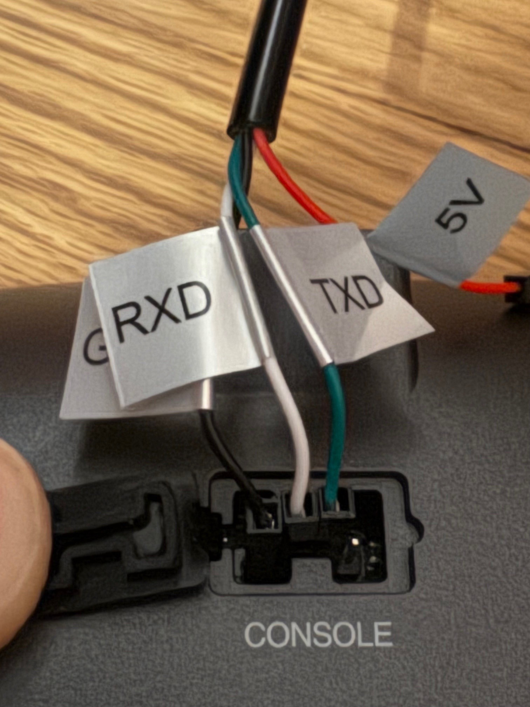

# OpenWrt for the Aruba IAP-305

An OpenWrt 24.10.7 port for the Aruba Instant AP-305 (IAP-305), tested on an **IAP-305-US**.
Prebuilt images are on the [Releases](../../releases) page, or you can build them yourself from the patch.

Both radios work, each using the AP's own factory calibration:
- 2.4 GHz from the IPQ4019
- 5 GHz from the external QCA9990 (PCIe, 3x3)

> Community port, not an official OpenWrt target. Use at your own risk, and back up your flash first (step 4).

## Compatibility

| Model | Status |
|---|---|
| **IAP-305-US** (Instant) | Tested: installed and running from NAND |
| IAP-305-RW / other regions (Instant) | Untested. Probably the same hardware, but [Fr4ctbyte's](https://github.com/Fr4ctbyte/OpenWRT-Aruba305) IAP-305-RW used the console on `ttyMSM1`, not `ttyMSM0`. See step 3. |
| AP-305 (Campus, controller-managed) | Not supported. Reported Campus units have an APBoot without `netget`/`bootm` ([Fr4ctbyte issue #3](https://github.com/Fr4ctbyte/OpenWRT-Aruba305/issues/3)), so there's no way to load the image. |

Nothing is written to flash until step 5. Steps 1–3 check your unit first: they confirm the bootloader commands exist, then boot OpenWrt from RAM. If your model isn't compatible, it fails there, and a power cycle returns you to ArubaOS.

## What's here

| Path | What it is |
|---|---|
| `patches/0001-ipq40xx-add-support-for-Aruba-AP-305.patch` | Complete patch against OpenWrt `v24.10.7`: DTS, image profile, network, sysupgrade, `fw_printenv` |
| `dts/qcom-ipq4029-ap-305.dts` | The same device tree, for reading |
| `console-pins.jpeg` | Serial header wiring on the test unit |

## Hardware

| | |
|---|---|
| SoC | Qualcomm IPQ4029, 4x Cortex-A7 |
| RAM | 512 MiB |
| Flash | 128 MiB NAND (MX30LF1G18AC) + 4 MiB SPI-NOR (MX25R3235F) |
| 2.4 GHz | IPQ4019 internal radio (AHB) |
| 5 GHz | QCA9990 on PCIe |
| Ethernet | 1x gigabit (AR8035 PHY), PoE in |
| Bootloader | APBoot 2.4.0.8 (build 64221), `boardname=Glenmorangie` |
| Serial | 4-pin header, 9600 8N1, 3.3 V. Linux console on **ttyMSM0** |

## Status

| Working | Not working / not tested |
|---|---|
| Boot from NAND | AD7416 temperature sensor (not detected at 0x48 on the test unit) |
| Ethernet (1 Gbps) | TPM, power monitor, BLE radio (no drivers) |
| 2.4 GHz and 5 GHz Wi-Fi, with factory calibration (`cal pre-cal-nvmem`) | LEDs and USB port (configured, not yet verified) |
| Hardware watchdog (gpio3) | |

## Differences from other AP-305 ports

This is based on OpenWrt's AP-365 support and on [Fr4ctbyte/OpenWRT-Aruba305](https://github.com/Fr4ctbyte/OpenWRT-Aruba305), with these changes:

- **Serial console on `ttyMSM0` (UART @ 0x78af000).** With the AP-303/AP-365 setting (`ttyMSM1`), the test unit gave no kernel output. The DTS now pins the `serial0`/`serial1` aliases and a `stdout-path`. Your APBoot `bootargs` still need `console=ttyMSM0,9600n8`, because a `console=` on the command line overrides the DTS.
- **Serial header wiring differs from Fr4ctbyte's docs** on this unit; see step 1.
- **procd uses the SoC watchdog, not the external one (fixes a boot loop).** The AP-305's external watchdog (fed by gpio3) resets the board when it's kicked in quick bursts. procd sends such a burst whenever it opens `/dev/watchdog` or changes the timeout, so earlier builds reset at random during boot, usually around `init: - watchdog -` (≈15 s) or `procd: - early -` (≈25 s). Watchdog aliases in the DTS now make the SoC watchdog `watchdog0`/`/dev/watchdog`. The external chip is fed only by the kernel's steady 500 ms keepalive. Builds before `v24.10.7-2` have this bug.
- **Pull-up on the console UART pins (gpio16/17)**, so the RX line doesn't float when no serial adapter is attached.
- **The patch includes the DTS file.** Fr4ctbyte's `0001` patch doesn't.
- **SPI-NOR chip select declared active-low**, as in current OpenWrt main for AP-303/AP-365.
- **gpio61 and gpio68 (Wi-Fi LEDs) removed from the NAND pinmux group**, so the NAND controller and the LED driver never claim the same pin.
- **Unused PCIe `wake-gpio` removed.** gpio50 is the reset button.
- **`fw_printenv`/`fw_setenv` support** (`u-boot-env` on mtd8, as on AP-365).
- **Step 5 wipes `aos1` with `ubiformat`** before `sysupgrade`, as in the official AP-303 guide. This avoids "Volume kernel not found".

On the compiled device tree, OpenWrt can only write to two places: `u-boot-env` and NAND `aos1` (`ubi`). The bootloader partitions, ART (calibration), mfginfo (MAC addresses) and `aos0` are all read-only. GPIOs 2 (board reset), 39 and 40 (watchdog control) are never touched.

## Prebuilt images

Each [release](../../releases) has three files:

| File | Use |
|---|---|
| `openwrt-…-aruba_ap-305-initramfs-uImage.itb` | RAM-boot image (install step 3). Rename it to `ipq40xx.ari` for TFTP. |
| `openwrt-…-aruba_ap-305-squashfs-sysupgrade.bin` | The image written to NAND (install step 5) |
| `SHA256SUMS` | Checksums |

Verify the files after downloading:

```sh
sha256sum -c SHA256SUMS --ignore-missing
```

Both files must report `OK`. The images were built from this repo's patch on unmodified OpenWrt `v24.10.7`, with the `.config` shown under Build (LuCI included). They don't contain any calibration or MAC data; each AP reads its own from flash at boot.

If you'd rather not trust a binary from the internet, build it yourself; the result is the same.

## Build

Optional if you use the prebuilt images. You need Ubuntu/Debian, run as a normal user, not root.

```sh
sudo apt install build-essential clang flex bison g++ gawk gcc-multilib g++-multilib \
  gettext git libncurses-dev libssl-dev python3-setuptools rsync swig unzip \
  zlib1g-dev file wget ccache

git clone --branch v24.10.7 https://github.com/openwrt/openwrt.git
cd openwrt
./scripts/feeds update -a && ./scripts/feeds install -a

git apply --check /path/to/patches/0001-ipq40xx-add-support-for-Aruba-AP-305.patch
git apply /path/to/patches/0001-ipq40xx-add-support-for-Aruba-AP-305.patch

cat > .config <<'EOF'
CONFIG_TARGET_ipq40xx=y
CONFIG_TARGET_ipq40xx_generic=y
CONFIG_TARGET_ipq40xx_generic_DEVICE_aruba_ap-305=y
CONFIG_PACKAGE_luci=y
CONFIG_CCACHE=y
EOF
make defconfig
make download -j16
make -j$(nproc)
ls bin/targets/ipq40xx/generic/ | grep aruba_ap-305
```

`make defconfig` may warn about packages like `onionshare-cli` and `python-pika`; that's harmless.

If `make download` seems stuck, broken IPv6 is the usual cause: `echo "inet4_only = on" >> ~/.wgetrc`.

## Install

### 1. Serial console

You need a 3.3 V USB-to-serial adapter (CP2102, FT232, CH340…).



The 4-pin CONSOLE header, left to right as shown in the photo:

| AP header pin | Connect to adapter |
|:---:|:---:|
| 1 (left) | **GND** |
| 2 | **RXD** |
| 3 | **TXD** |
| 4 (right) | nothing (leave unconnected) |

So pin 2 is the AP's transmit line and pin 3 is its receive line. That's the reverse of the labels in Fr4ctbyte's docs. If you see no text at all, swap the two data wires; that can't damage anything at 3.3 V. Never connect pin 4 or your adapter's 3V3/5V pin.

Terminal settings: **9600 baud, 8N1, no flow control.**

```sh
picocom -b 9600 -g boot.log /dev/ttyUSB0
```

On Ubuntu, stop anything that grabs USB serial ports before connecting:

```sh
sudo systemctl stop ModemManager brltty
```

Also close any 3D-printer software (slicers often scan serial ports).

### 2. PC network and TFTP

Connect the AP straight to the PC, and power it with PoE or 12 V DC.

```sh
sudo apt install tftpd-hpa
# The initramfs image, downloaded or from bin/targets/ipq40xx/generic/ if you built it
sudo cp openwrt-*-aruba_ap-305-initramfs-uImage.itb /srv/tftp/ipq40xx.ari
sudo chmod 644 /srv/tftp/ipq40xx.ari

# Static IP on the wired port (replace enp5s0); turn off ufw while installing
sudo nmcli con add type ethernet ifname enp5s0 con-name ap305 \
  ipv4.method manual ipv4.addresses 192.168.1.75/24 ipv4.never-default yes ipv6.method disabled
sudo nmcli con up ap305
```

APBoot only fetches a file named `ipq40xx.ari`. If your Wi-Fi is also on a 192.168.1.x network, turn it off while installing.

### 3. Boot OpenWrt from RAM (nothing is written)

Power on and tap Enter during the 2-second countdown. At `apboot>`:

```
diag
help
printenv
```

- Check that `help` lists `netget` and `bootm`. If it doesn't, stop; see Compatibility.
- Save the `printenv` output. It's your only record of the original settings.

```
setenv autostart n
setenv ipaddr 192.168.1.105
setenv serverip 192.168.1.75
setenv bootargs console=ttyMSM0,9600n8
netget 0x84000000 ipq40xx.ari
set fdt_high 0x87000000
bootm 0x84000000
```

- `autostart n` is required. Without it, `netget` tries to boot the file as a signed Aruba image and fails with `Invalid image format version: 0x<file size>`.
- `ipq: fdt fixup unable to find compatible node` is harmless.
- If no Linux text appears after that line and the AP resets about 10 seconds later, your unit uses the other UART. Try `setenv bootargs console=ttyMSM1,9600n8` instead, and use `ttyMSM1` in step 6 as well.

None of these settings are saved, so after a power cycle you have to enter them again.

Check that it works:

```sh
cat /sys/firmware/devicetree/base/compatible; echo   # aruba,ap-305
iw phy | grep Wiphy                                  # phy0 and phy1
dmesg | grep pre-cal-nvmem                           # one line per radio
cat /proc/mtd                                        # mtd1 = "ubi"
```

Leave it running for 5 minutes. If it reboots by itself, stop here.

### 4. Back up

Run `passwd` on the AP first, then from the PC (check the mtd numbers in `/proc/mtd`):

```sh
ssh root@192.168.1.1 'cat /dev/mtd10' > art.bin       # radio calibration
ssh root@192.168.1.1 'cat /dev/mtd14' > mfginfo.bin   # MAC addresses
ssh root@192.168.1.1 'cat /dev/mtd1'  > aos1.bin      # ArubaOS
ssh root@192.168.1.1 'cat /dev/mtd1'  > aos1-check.bin
sha256sum aos1.bin aos1-check.bin                     # must match
```

> **Warning:** on the test unit, `aos0` was empty (APBoot: `Invalid image format version: 0xffffffff` at 0x0). ArubaOS lived only on `aos1`, which step 5 erases. Keep `aos1.bin` safe, or get an ArubaInstant "Ursa" image before you continue.

Never publish your `art.bin`, `mfginfo.bin`, `aos1.bin` or boot logs. They contain your device's calibration and MAC addresses.

### 5. Flash to NAND

From the PC:

```sh
cat openwrt-*-aruba_ap-305-squashfs-sysupgrade.bin | ssh root@192.168.1.1 'cat > /tmp/sysupgrade.bin'
```

On the AP (confirm `mtd1` is `"ubi"` first):

```sh
ubidetach -p /dev/mtd1
ubiformat /dev/mtd1 -y
sysupgrade -n /tmp/sysupgrade.bin
```

`ubidetach` may say "not attached"; that's fine. The AP reboots by itself when the flash finishes.

### 6. Boot from NAND

Stop at `apboot>` as the AP reboots. Type each line exactly as shown, then check with `printenv` **before** `saveenv`:

```
setenv bootargs_openwrt "setenv bootargs console=ttyMSM0,9600n8"
setenv nandboot_openwrt "run bootargs_openwrt; ubi part aos1; ubi read 0x85000000 kernel; set fdt_high 0x87000000; bootm 0x85000000"
setenv bootcmd "run nandboot_openwrt"
printenv bootargs_openwrt nandboot_openwrt bootcmd
saveenv
boot
```

A mistyped `nandboot_openwrt` causes these symptoms:
- `Volume <NULL> not found!`
- APBoot falling back to an endless `DHCP broadcast` loop

If you see either, press Ctrl-C (or power-cycle and stop at `apboot>`) and re-enter the variable.

On the next boot, APBoot prints `Volume aos1 not found! Creating dynamic volume aos1`. That's harmless.

### 7. After install

- The installed system has **no root password**; the one from the RAM session is gone. Set it with `passwd` or in LuCI at http://192.168.1.1.
- Run `ssh-keygen -R 192.168.1.1` if SSH complains about a changed host key.
- Set the Wi-Fi country on both radios (LuCI: Network → Wireless → Advanced Settings).
- Optional: quiet console logging with `uci set system.@system[0].conloglevel='1' && uci commit system`.

## Back to stock

Not yet tested. To go back to ArubaOS:
1. Restore the original `bootcmd` from your saved `printenv` output, or use `purgeenv`.
2. Put an ArubaOS image back on `aos1`. Either:
   - write your `aos1.bin` back with `nandwrite`. It's a raw dump, so take care around bad blocks.
   - load an ArubaInstant "Ursa" (AP-30x) image through APBoot. This is likely the cleaner route.

## Credits

- OpenWrt AP-303/AP-365 support (David Bauer and others), whose Glenmorangie dtsi this builds on
- [Fr4ctbyte/OpenWRT-Aruba305](https://github.com/Fr4ctbyte/OpenWRT-Aruba305): GPIO, watchdog and calibration research; OpenWrt PR [#25001](https://github.com/openwrt/openwrt/pull/25001)
- [OpenWrt forum thread](https://forum.openwrt.org/t/openwrt-support-for-aruba-ap-305/63218)

## License

GPL-2.0-only, the same as OpenWrt (see `LICENSE`). The DTS is `GPL-2.0-only OR MIT`, as declared in its SPDX header.
